# Nexo Forms

Aplicativo Android para criar, distribuir e responder questionários, com fotos, acesso offline e sincronização entre celulares. A interface usa preto e azul, uma marca em SVG e uma imagem de apresentação na abertura.

O login diário é direto por **e-mail e senha**. A conexão é pré-configurada; seus ajustes ficam no menu **⋯**, separado do formulário de login.

## Perfis e permissões

| Perfil | O que pode fazer |
| --- | --- |
| Proprietário / administrador | Cadastrar participantes, criar formulários, atribuir usuários, acompanhar envios e consultar respostas e fotos da equipe. |
| Participante | Ver somente formulários atribuídos à sua conta, responder, anexar fotos, salvar rascunhos, concluir e sincronizar suas respostas. |

O proprietário configurado é **r.abelismerim@gmail.com**. O primeiro cadastro desse e-mail cria o administrador. Usuários cadastrados pela administração recebem o perfil de participante. As permissões também são verificadas pela API.

## Prévias das telas

As imagens abaixo apresentam os componentes da interface com dados demonstrativos em uma prévia para navegador. A validação em um celular Android continua necessária para câmera, galeria e armazenamento nativo.

<details open>
<summary><strong>Abertura e acesso</strong></summary>

| Login | Login offline |
| --- | --- |
|  | 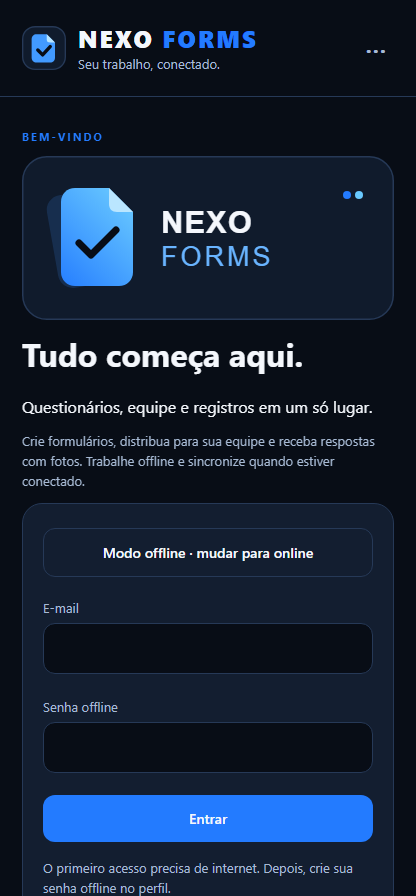 |

| Ajustes de conexão | Ativação do proprietário |
| --- | --- |
| 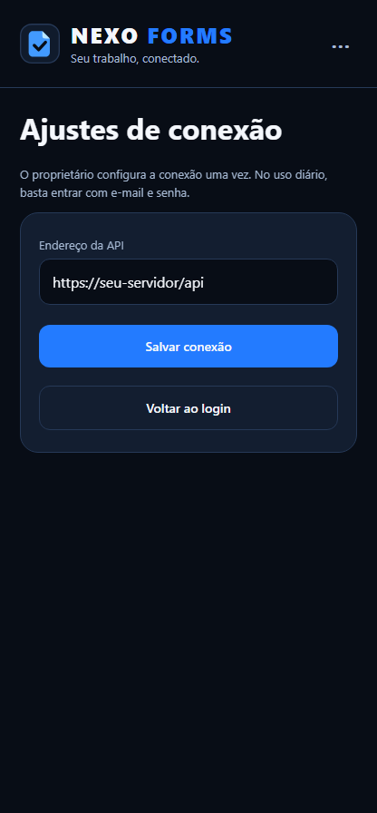 | 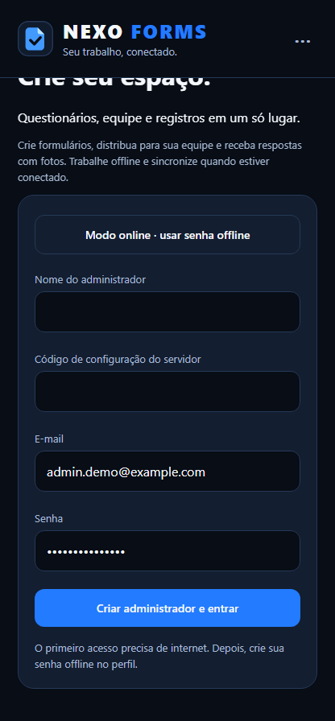 |

</details>

<details open>
<summary><strong>Área do participante</strong></summary>

| Questionários pendentes atribuídos | Responder questionário |
| --- | --- |
| 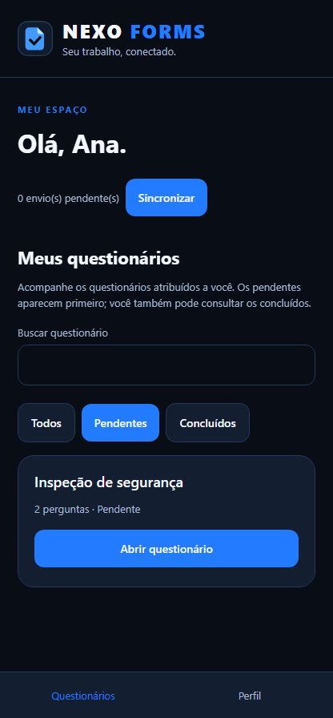 | 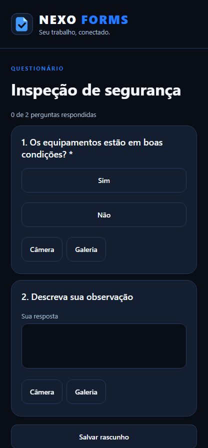 |

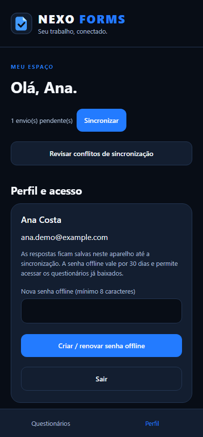

</details>

<details>
<summary><strong>Área do administrador</strong></summary>

| Painel | Cadastro de participantes |
| --- | --- |
| 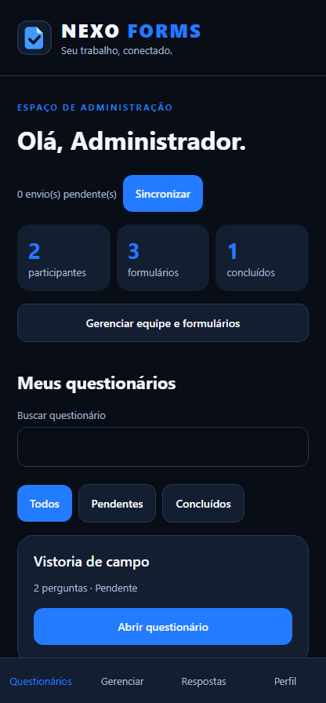 | 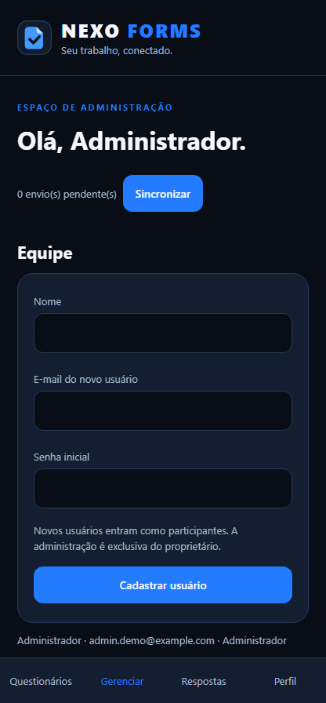 |

| Criar formulário | Atribuir usuários |
| --- | --- |
| 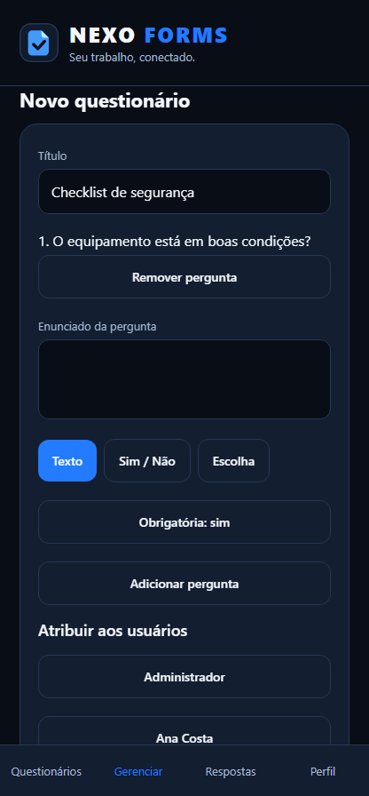 | 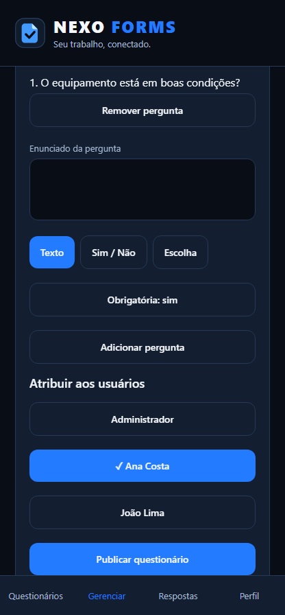 |

| Receber respostas e fotos | Perfil do administrador |
| --- | --- |
| 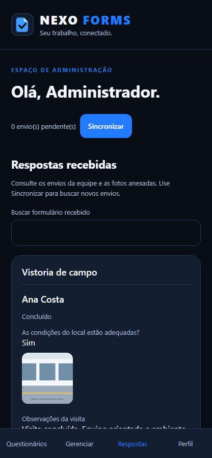 | 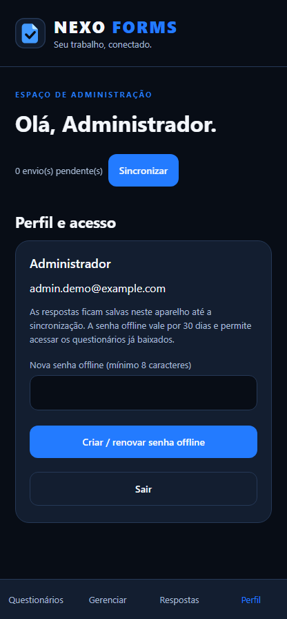 |

</details>

<details>
<summary><strong>Questionário, fotos e conflitos</strong></summary>

| Questionário atribuído ao administrador | Foto ampliada |
| --- | --- |
| 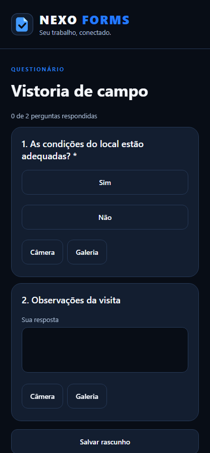 | 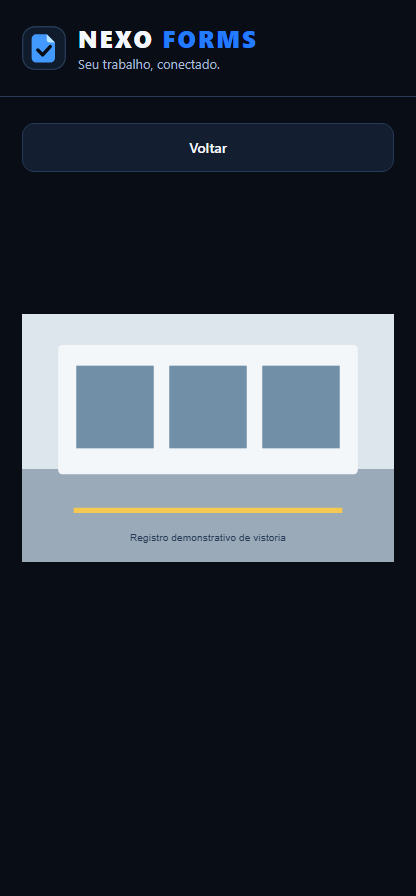 |

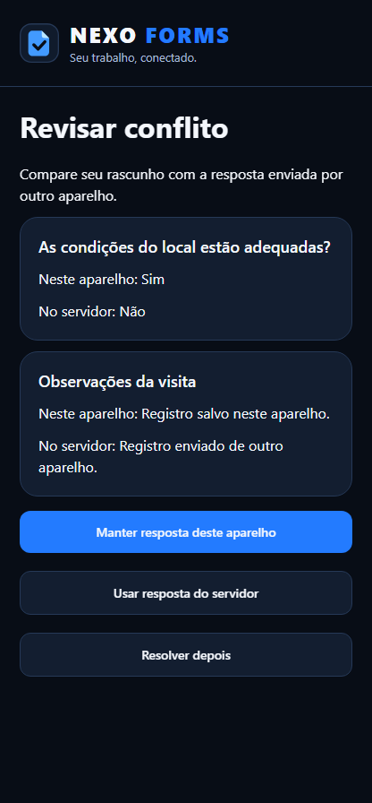

</details>

## Mapa das telas

| Tela ou seção | Como acessar | Perfil | Finalidade |
| --- | --- | --- | --- |
| Abertura / login | Ao abrir o aplicativo | Todos | Apresentação do sistema e entrada por e-mail e senha. |
| Login offline | Botão de modo offline na abertura | Todos | Entrar com a senha offline e consultar os dados baixados. |
| Ativação do espaço | Primeiro acesso, quando não há administrador cadastrado | Proprietário | Cadastrar o administrador usando o e-mail configurado e o código de ativação. |
| Ajustes de conexão | Menu ⋯ na abertura | Antes do login | Configurar o endereço da API para a instalação. |
| Painel administrativo | Após o login do proprietário | Administrador | Resumo de participantes, formulários e envios concluídos. |
| Equipe | Gerenciar → Equipe | Administrador | Cadastrar nome, e-mail e senha inicial dos participantes. |
| Novo questionário | Gerenciar → Novo questionário | Administrador | Montar perguntas, escolher tipos de resposta e obrigatoriedade. |
| Atribuição de usuários | Novo questionário → Atribuir; ou formulário publicado → Alterar usuários atribuídos | Administrador | Definir quem recebe cada formulário. |
| Meus questionários | Após o login do participante; aba Questionários | Participante | Listar somente seus formulários. O filtro inicial é Pendentes; há também Todos e Concluídos. |
| Responder questionário | Abrir questionário | Usuário atribuído | Responder perguntas, adicionar fotos, salvar e concluir. |
| Respostas recebidas | Aba Respostas | Administrador | Consultar os envios, identificar o participante e visualizar as fotos. |
| Perfil e acesso | Aba Perfil | Todos | Conferir a conta, criar ou renovar senha offline e sair. |
| Foto ampliada | Toque em uma foto anexada | Usuário com acesso à resposta | Ampliar o anexo e voltar à tela de origem. |
| Revisar conflito | Revisar conflitos de sincronização | Usuário com envio pendente | Comparar versões e escolher a resposta local ou a do servidor. |

O administrador também pode responder formulários quando estiver entre os usuários atribuídos.

## Instalação e primeiro acesso

### 1. Preparar o ambiente

Use Windows, Node.js 22 e PowerShell. O projeto disponibiliza um instalador local para as dependências:

```powershell
Set-ExecutionPolicy -Scope Process Bypass
.\scripts\install-dependencies.ps1
```

Os SDKs ficam em `.tools`, e os pacotes do aplicativo em `NexoFormsApp/node_modules`.

| Componente | Configuração do projeto |
| --- | --- |
| React Native / React | 0.79.6 / 19.0.0 |
| API | .NET 10 |
| Java | JDK 17 |
| Android | SDK 35, Build Tools 35.0.0, NDK 27.1.12297006 |

Os fornecedores oficiais são [Microsoft .NET](https://dotnet.microsoft.com/download/dotnet/10.0), [Eclipse Temurin](https://adoptium.net/temurin/releases/?version=17) e [Android Developers](https://developer.android.com/studio).

### 2. Iniciar a API

Na raiz do projeto:

```powershell
powershell -ExecutionPolicy Bypass -File .\scripts\start-api.ps1
```

Mantenha esse terminal aberto. A API atende na porta **5000**. O código do primeiro cadastro é criado no arquivo `.tools/owner-setup-code.txt`.

Este build aponta inicialmente para `http://192.168.1.10:5000/api`. Para usar outro endereço, ajuste a conexão pelo menu **⋯** do aplicativo, ou informe a URL ao gerar o APK. Todos os celulares precisam acessar a mesma API. Para uso na rede local, conecte o computador e os aparelhos à mesma rede e permita o acesso à porta 5000. Para uso fora dessa rede, disponibilize a API por HTTPS.

### 3. Gerar e instalar o aplicativo

```powershell
powershell -ExecutionPolicy Bypass -File .\scripts\build-android.ps1
```

O APK ARM64 fica em `.artifacts/NexoForms-arm64-v8a.apk`. Transfira o arquivo para um celular Android ARM64 e instale. Trata-se de uma distribuição de teste, assinada com a configuração de desenvolvimento.

Para gerar com outro endereço já configurado:

```powershell
powershell -ExecutionPolicy Bypass -File .\scripts\build-android.ps1 -ApiUrl https://seu-endereco/api
```

### 4. Ativar seu acesso de administrador

1. Inicie a API e abra o app.
2. Informe **r.abelismerim@gmail.com** e escolha sua senha, com pelo menos oito caracteres.
3. Toque em **Entrar**. No primeiro acesso, o app apresenta a ativação do espaço.
4. Informe seu nome e o código do arquivo `.tools/owner-setup-code.txt`.
5. Toque em **Criar administrador e entrar**.
6. Nos próximos acessos, use somente seu e-mail e senha.

O e-mail do proprietário está em `NexoFormsApi/appsettings.json`, na configuração `Nexo.OwnerEmail`.

## Passo a passo do administrador

### Cadastrar participantes

1. Entre online com sua conta de administrador.
2. Abra **Gerenciar → Equipe**.
3. Preencha nome, e-mail e senha inicial do participante.
4. Toque em **Cadastrar usuário**.
5. Entregue as credenciais ao participante para que ele entre no próprio celular.

### Criar e distribuir um formulário

1. Em **Gerenciar**, vá até **Novo questionário**.
2. Informe o título.
3. Escreva o enunciado da primeira pergunta.
4. Escolha **Texto**, **Sim / Não** ou **Escolha**. Para Escolha, escreva uma opção por linha, com pelo menos duas opções.
5. Defina se a resposta é obrigatória e toque em **Adicionar pergunta**.
6. Repita para as demais perguntas. Use **Remover pergunta** para excluir uma pergunta antes da publicação.
7. Em **Atribuir aos usuários**, selecione os participantes que receberão o formulário.
8. Toque em **Publicar questionário**.
9. Para ajustar os participantes depois, abra o formulário em **Questionários publicados**, toque em **Alterar usuários atribuídos**, selecione as contas e salve.

As perguntas de um formulário publicado permanecem fixas para manter a consistência das respostas. Para outro conjunto de perguntas, publique um novo formulário.

### Receber os formulários respondidos

1. Oriente os participantes a concluir e sincronizar os envios.
2. No seu aplicativo, toque em **Sincronizar**.
3. Abra a aba **Respostas**.
4. Busque pelo título do formulário.
5. Confira o nome do participante, a situação do envio, as respostas e as fotos.
6. Toque em uma foto para ampliar e em **Voltar** para retornar.

Rascunhos sincronizados aparecem identificados como rascunhos; envios concluídos aparecem como concluídos.

## Passo a passo do participante

1. Abra o app e entre com o e-mail e a senha fornecidos pelo administrador.
2. A área **Meus questionários** mostra somente os formulários vinculados à sua conta. Os **Pendentes** aparecem primeiro.
3. Use a busca ou os filtros **Todos**, **Pendentes** e **Concluídos**.
4. Toque em **Abrir questionário**.
5. Responda às perguntas. As obrigatórias têm um asterisco.
6. Use **Câmera** ou **Galeria** para adicionar fotos. O limite é de cinco fotos por pergunta; há também um limite total de anexos por formulário.
7. Toque em **Salvar rascunho** para continuar depois, ou em **Concluir e salvar** quando terminar.
8. Na área principal, toque em **Sincronizar** para enviar respostas e fotos.
9. O administrador poderá consultar o envio após atualizar seu aplicativo.

As fotos aceitas são JPEG e PNG. Respostas e fotos salvas permanecem no aparelho ao fechar o app ou sair da conta.

## Acesso offline e sincronização

### Preparar o acesso offline

1. Faça um login online no aparelho.
2. Toque em **Sincronizar** para atualizar os formulários atribuídos.
3. Abra **Perfil**, informe uma senha offline com pelo menos oito caracteres e toque em **Criar / renovar senha offline**.
4. A senha offline é válida por **30 dias** e é independente da senha de login online.

### Trabalhar sem internet

1. Na abertura, selecione o modo offline.
2. Informe seu e-mail e a senha offline criada nesse aparelho.
3. Responda aos formulários já baixados e salve os rascunhos ou conclusões.
4. Ao ter conexão novamente, entre online e toque em **Sincronizar**.

O cadastro de usuários, a publicação e a atribuição de formulários exigem acesso online. O login offline dá acesso aos dados que já estão no aparelho.

### Resolver conflitos entre aparelhos

1. Se uma resposta tiver sido atualizada em outro aparelho, a sincronização informa o conflito e preserva o rascunho local.
2. Toque em **Revisar conflitos de sincronização**.
3. Compare as respostas e fotos locais com as do servidor.
4. Escolha **Manter resposta deste aparelho** ou **Usar resposta do servidor**. Também é possível resolver depois.

## Estrutura do projeto

```text
NexoFormsApp/
  App.tsx                          Entrada do aplicativo
  src/workspace/WorkspaceApp.tsx    Telas e navegação por perfil
  src/workspace/service.ts         API, cache e fila offline
  src/workspace/config.ts          Endereço inicial da API
  src/assets/brand/                Marca SVG e apresentação
  android/                        Projeto Android
  __tests__/                      Testes do aplicativo
NexoFormsApi/
  Controllers/WorkspaceController.cs  Autenticação e operações do espaço
  appsettings.json                   Configuração do proprietário
scripts/                          Instalação, API, build e testes
docs/screenshots/                 Imagens das telas
```

A API usa armazenamento persistente em `NexoFormsApi/App_Data/workspace.json`, incluindo usuários, sessões, formulários, respostas e fotos. Mantenha uma cópia de segurança dessa pasta. A configuração atende uma instância da API; o uso de múltiplas instâncias exige armazenamento compartilhado.

No aparelho, o SQLite guarda os dados e a fila de envios. A senha offline é armazenada como hash bcrypt no armazenamento de credenciais do dispositivo. No servidor, as senhas usam PBKDF2. O cache é separado por usuário e endereço da API.

## Desenvolvimento e testes

Para executar o aplicativo com Metro:

```powershell
Set-ExecutionPolicy -Scope Process Bypass
. .\scripts\env.ps1
cd NexoFormsApp
npm start
```

Em outro terminal, carregue o mesmo ambiente, entre em `NexoFormsApp` e execute `npm run android` com um aparelho conectado ou um emulador Android funcional.

Verificações do aplicativo:

```powershell
cd NexoFormsApp
npx tsc --noEmit
npm run lint
npm test -- --runInBand
```

Verificações da API, a partir da raiz:

```powershell
. .\scripts\env.ps1
dotnet restore NexoFormsApi --configfile NuGet.Config
dotnet build NexoFormsApi --no-restore
python scripts/test-api.py
```

Os testes de API usam um espaço isolado, sem modificar os dados do administrador. Eles verificam autenticação, permissões, atribuições, respostas, fotos, conflitos, persistência e encerramento de sessão. Os testes do app verificam os perfis, a lista de pendências do participante, o login, a fila offline e as credenciais.
